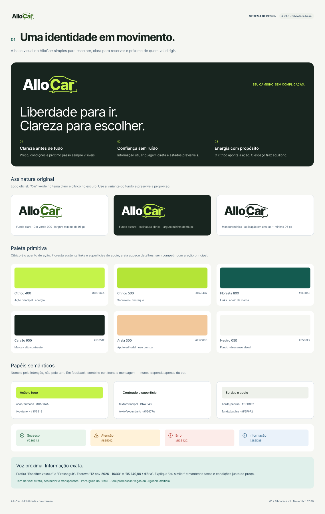
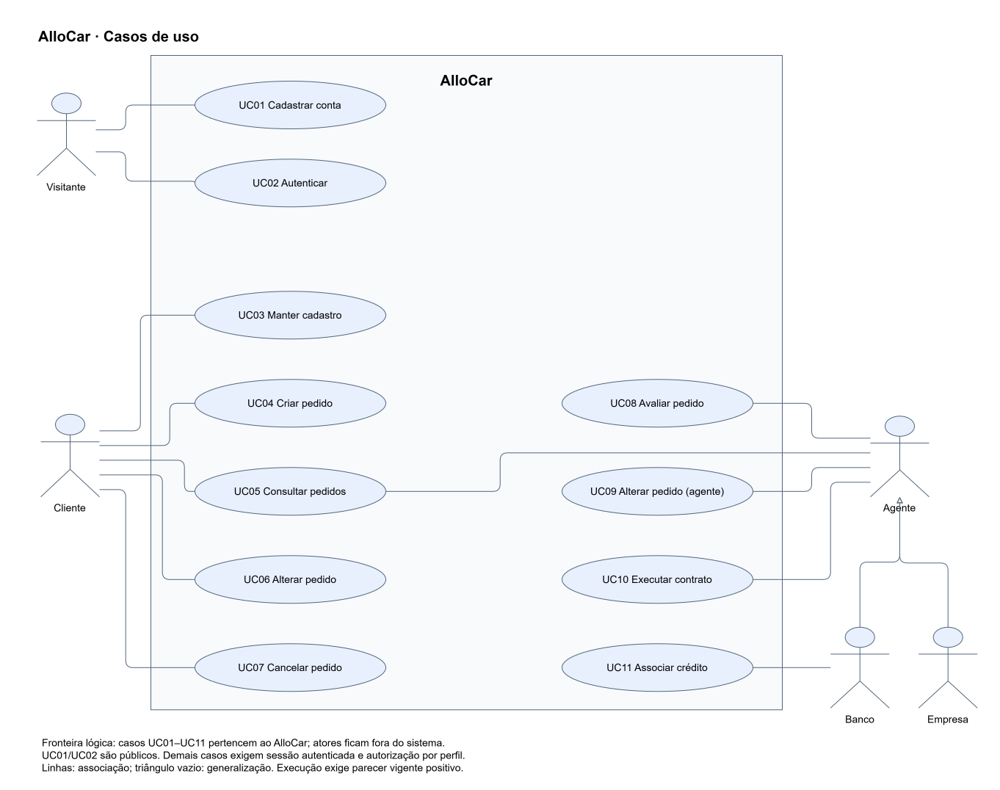
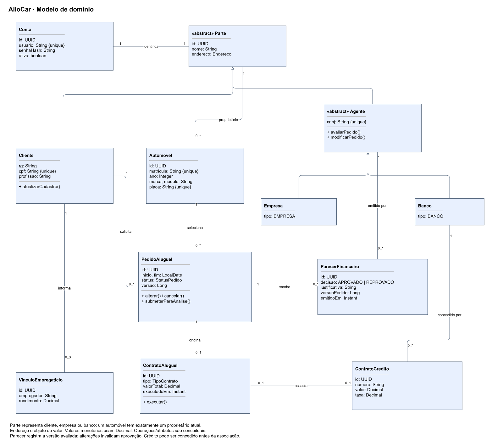
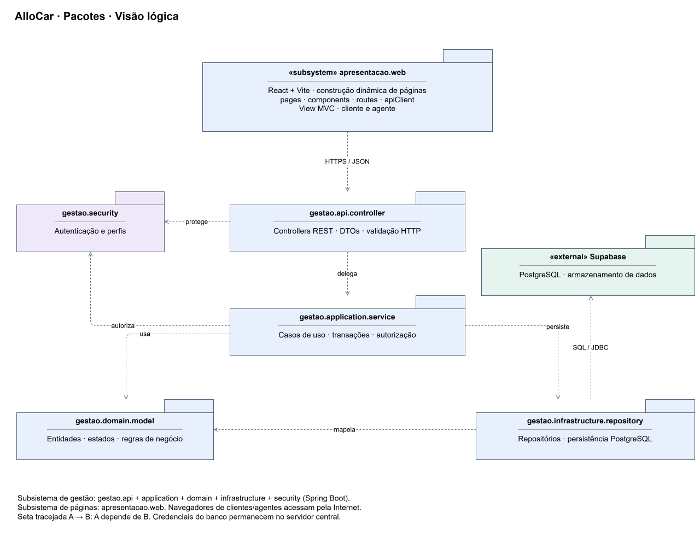
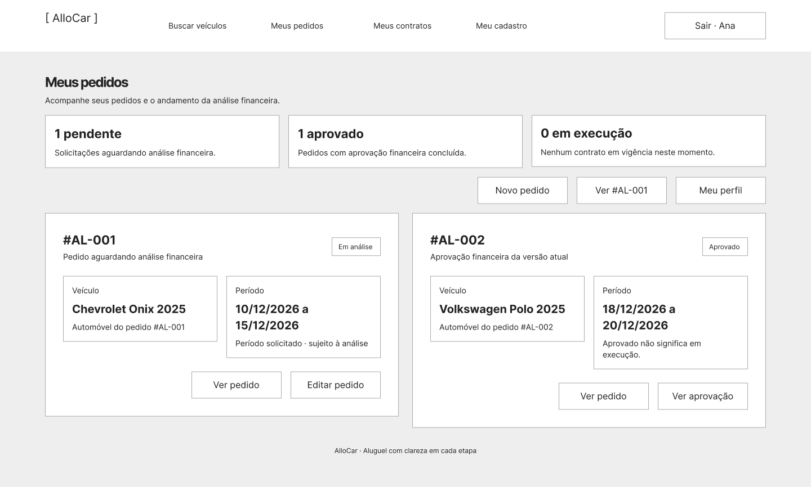
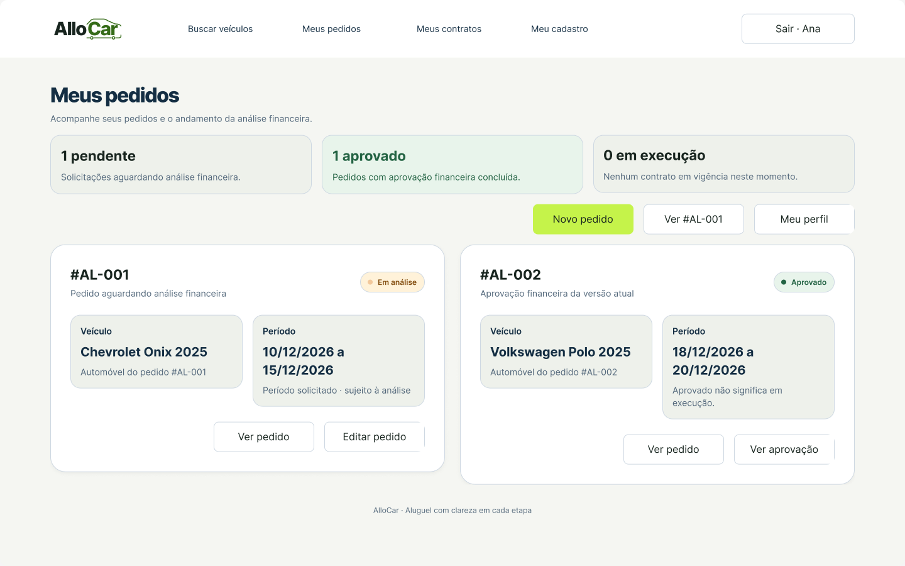
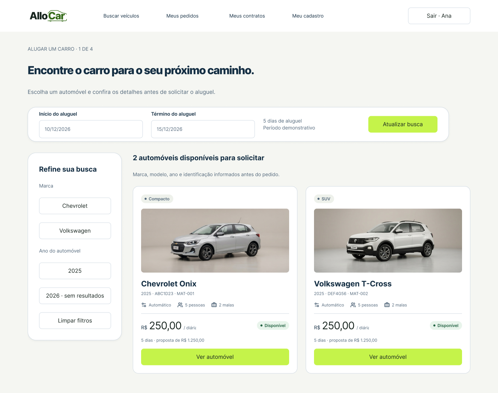
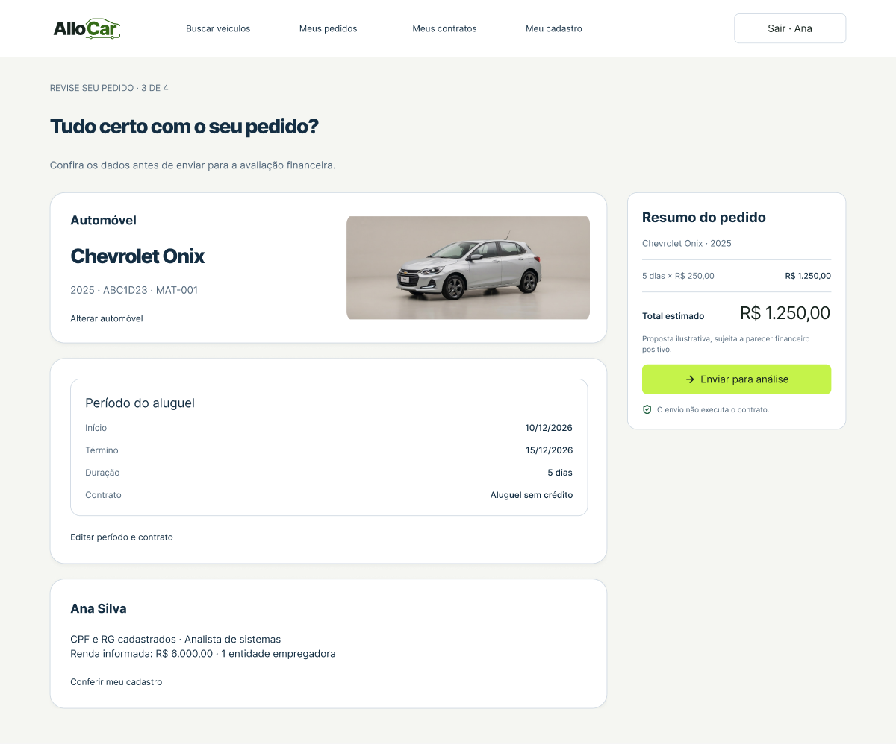

<p align="center">
    
</p>

---

Sistema web de aluguel de carros que conecta clientes, empresas e bancos na solicitação, análise financeira e contratação de aluguéis.

## 📚 Índice

- [Links úteis](#-links-úteis)
- [Sobre o projeto](#-sobre-o-projeto)
- [Funcionalidades principais](#-funcionalidades-principais)
- [Tecnologias utilizadas](#-tecnologias-utilizadas)
- [Design system](#-design-system)
- [Arquitetura e diagramas](#-arquitetura)
- [Histórias de usuário](#-histórias-de-usuário)
- [Consulta dos artefatos](#-consulta-dos-artefatos)
- [Estrutura de pastas](#-estrutura-de-pastas)
- [Demonstração e protótipos](#-demonstração)
- [Autor](#-autor)

## 🔗 Links Úteis

| Recurso                                   | Acesso                                                                                                                           |
| ----------------------------------------- | -------------------------------------------------------------------------------------------------------------------------------- |
| Requisitos, regras, estados e arquitetura | [Modelagem detalhada](docs/modelagem.md)                                                                                         |
| Histórias e critérios de aceitação        | [Histórias de usuário](docs/historias-de-usuario.md)                                                                             |
| Classes e regras do backend               | [Modelo e operações](docs/backend.md) |
| API REST e integração com o frontend      | [Rotas, autenticação e exemplos JSON](docs/api.md) |
| Banco de dados e conexão                  | [Configuração, tabelas e dados fictícios](docs/database.md) |
| Diagramas editáveis                       | [Fontes draw.io e prévias](docs/diagramas/)                                                                                      |
| Protótipos editáveis                      | [Arquivo Figma](https://www.figma.com/design/BhQ1Hh0Rofd4t0k7EVWZgK)                                                             |
| Wireframes navegáveis                     | [Apresentar baixa fidelidade](https://www.figma.com/proto/BhQ1Hh0Rofd4t0k7EVWZgK?node-id=4-1697&starting-point-node-id=4%3A1697) |
| Interface                                 | [Apresentar alta fidelidade](https://www.figma.com/proto/BhQ1Hh0Rofd4t0k7EVWZgK?node-id=4-1017&starting-point-node-id=4%3A1017)  |
| Design system e componentes               | [Documentação e inventário](docs/design-system/README.md)                                                                        |

## 📝 Sobre o Projeto

O AlloCar centraliza pedidos de aluguel feitos pela Internet. Clientes cadastrados solicitam automóveis e consultam, alteram ou cancelam seus pedidos. Empresas e bancos atuam como agentes: modificam propostas, realizam análise financeira e dão continuidade aos contratos após parecer positivo.

O cadastro de cada cliente contempla RG, CPF, nome, endereço, profissão e até três entidades empregadoras com seus rendimentos. Automóveis possuem matrícula, ano, marca, modelo e placa, podendo pertencer a clientes, empresas ou bancos. Um aluguel também pode estar associado a crédito concedido por banco agente

## ✨ Funcionalidades Principais

- Cadastro prévio e login com usuário e senha para clientes e agentes.
- Cadastro do cliente com identificação, endereço, profissão e até três vínculos de renda.
- Criação, consulta, alteração e cancelamento de pedidos pelo cliente.
- Consulta e modificação de pedidos por agentes autorizados.
- Avaliação financeira com decisão, justificativa e versão do pedido.
- Execução de contrato condicionada à aprovação financeira vigente.
- Propriedade de automóveis por cliente, empresa ou banco, conforme o contrato.
- Associação opcional de crédito concedido por banco agente.

## 🛠 Tecnologias Utilizadas

| Área                     | Tecnologia                           |
| ------------------------ | ------------------------------------ |
| Modelagem UML            | draw.io / diagrams.net               |
| Prototipação             | Figma Design                         |
| Interface dos protótipos | Inter e design system nativo AlloCar |
| Documentação             | Markdown, SVG e PNG                  |
| Front-end                | React + Vite                         |
| Back-end                 | Java JDK 25 + Spring Boot 4.0.x      |
| Build                    | Apache Maven                         |
| Banco de dados           | Supabase — PostgreSQL                |
| Arquitetura              | MVC                                  |

## 🖥️ Design System

O Figma possui quatro páginas: **Design System**, **Componentes nativos**, **Protótipo alta fidelidade** e **Wireframes**. A biblioteca própria reúne **65 famílias**: 43 componentes independentes e 22 conjuntos de variantes, incluindo logo, botões, campos, navegação, feedback, tabelas e padrões de locação.

As fundações possuem 57 variáveis primitivas, 29 semânticas, 53 estilos de texto Inter e três estilos de elevação. O acento principal é cítrico `#C5F34A`, com carvão `#18251F`, floresta `#145B50` e superfícies claras `#F5F6F2`. As coleções Interface e Wireframe reúnem outras 14 variáveis.



A logo com carro integrado foi exportada diretamente do componente nativo, nas aplicações para [fundo claro](docs/allocar-logo-claro.svg), [fundo escuro](docs/allocar-logo.svg) e [monocromática](docs/allocar-logo-monocromatica.svg). Consulte o [design system](docs/design-system/README.md) para tokens, componentes, exemplos desktop/mobile e limites de escopo.

## 🏗 Arquitetura

O sistema usa um servidor central Spring Boot, com Controllers REST, serviços de aplicação, domínio e repositórios. O React + Vite constrói dinamicamente as páginas e consome a API por HTTPS/JSON. O servidor persiste os dados no PostgreSQL do Supabase e verifica autenticação e autorização em cada operação protegida.

Os dois subsistemas são **gestão de pedidos e contratos**, no back-end, e **construção dinâmica das páginas web**, no front-end. No MVC, a apresentação React representa a View; os Controllers expõem as operações; entidades, regras e persistência compõem o Model. Essa separação permite revisar interface e regras de negócio de forma independente.

### Diagramas UML

As imagens abaixo são prévias vetoriais das fontes editáveis. Para editar, abra o `.drawio` em [diagrams.net](https://app.diagrams.net/) usando **Arquivo → Abrir de → Dispositivo**.

#### Casos de uso



[Fonte editável](docs/diagramas/casos-de-uso.drawio). Atores: visitante, cliente e agente, com especializações empresa e banco. Login e cadastro são públicos; todos os casos de negócio exigem autenticação.

#### Classes



[Fonte editável](docs/diagramas/classes.drawio). O domínio relaciona conta, partes, cliente e rendimentos, agentes, automóvel, pedido, parecer, contrato e crédito. Multiplicidades explicitam o limite de três rendimentos, contrato único por pedido e crédito opcional.

#### Pacotes — visão lógica



[Fonte editável](docs/diagramas/pacotes.drawio). Setas tracejadas representam dependências entre pacotes dos dois subsistemas.

### Decisões e premissas

O ciclo de vida do pedido compreende os estados `EM_ANALISE`, `APROVADO`, `REPROVADO`, `CANCELADO` e `EM_EXECUCAO`. Alterar um pedido invalida o parecer anterior. Cancelamento e alteração são permitidos antes da execução; a contratação exige aprovação da versão atual do pedido. As [regras de domínio](docs/modelagem.md) detalham essas condições.

## 📖 Histórias de Usuário

| ID   | História                                                                                  | UC   |
| ---- | ----------------------------------------------------------------------------------------- | ---- |
| HU01 | Como visitante, quero cadastrar minha conta para obter acesso ao AlloCar.                 | UC01 |
| HU02 | Como usuário, quero entrar com usuário e senha para acessar as operações do meu perfil.   | UC02 |
| HU03 | Como cliente, quero manter meus dados e rendimentos para viabilizar a análise financeira. | UC03 |
| HU04 | Como cliente, quero solicitar um automóvel por um período para iniciar meu aluguel.       | UC04 |
| HU05 | Como cliente, quero consultar meus pedidos e status para acompanhar o atendimento.        | UC05 |
| HU06 | Como cliente, quero alterar meu pedido para corrigir a proposta antes da execução.        | UC06 |
| HU07 | Como cliente, quero cancelar meu pedido para desistir da solicitação.                     | UC07 |
| HU08 | Como agente, quero consultar a fila autorizada para organizar as análises.                | UC05 |
| HU09 | Como agente, quero emitir parecer financeiro para aprovar ou reprovar pedidos.            | UC08 |
| HU10 | Como agente, quero modificar pedidos autorizados para adequar a proposta.                 | UC09 |
| HU11 | Como agente, quero executar contratos aprovados para formalizar os aluguéis.              | UC10 |
| HU12 | Como banco, quero associar crédito concedido ao aluguel para registrar seu financiamento. | UC11 |

Os [critérios de aceitação, prioridades e vínculos com telas e classes](docs/historias-de-usuario.md) detalham cada história, inclusive fluxos alternativos e restrições por perfil.

## 🔧 Consulta dos Artefatos

Para consultar os artefatos:

1. Leia este README e a modelagem detalhada.
2. Abra os diagramas SVG pelo repositório ou as fontes `.drawio` no diagrams.net.
3. Abra uma apresentação no Figma e percorra os fluxos de cliente, agente e banco. Na análise, escolha aprovar ou reprovar antes de salvar.

## 📂 Estrutura de Pastas

```text
allocar/
├── README.md
├── backend/
│   ├── pom.xml
│   └── src/
│       ├── main/java/com/allocar/backend/
│       │   ├── application/   # BackendApplication.java
│       │   ├── controller/    # entrada HTTP
│       │   ├── model/         # entidades e regras de negócio
│       │   ├── repository/    # persistência
│       │   └── service/       # casos de uso, transações e conexão JDBC
│       └── test/java/         # testes do backend
└── docs/
    ├── allocar-logo.svg        # export oficial para fundo escuro
    ├── allocar-logo-claro.svg
    ├── allocar-logo-monocromatica.svg
    ├── modelagem.md
    ├── backend.md
    ├── api.md
    ├── database.md
    ├── historias-de-usuario.md
    ├── gerar-diagramas.cjs
    ├── design-system/          # tokens, inventário e prévias da biblioteca
    ├── diagramas/              # .drawio, XML nativo e prévias .svg
    └── prototipos/             # guia, prévias PNG e mapa de nós Figma
```

## 🎨 Demonstração

### Landing page

A página inicial apresenta a AlloCar, explica as etapas do aluguel, mostra categorias de veículos e responde dúvidas frequentes. Os botões levam ao cadastro e ao acesso; os menus desktop rolam até as seções correspondentes. Há layouts desktop de **1440 px** e mobile de **390 px**, com logo, botões, cartões, metadados e acordeões nativos da biblioteca. As fotos foram reutilizadas dos assets existentes; os valores dos cartões são ilustrativos.

[Prévia desktop](docs/prototipos/landing-desktop.png) · [Prévia mobile](docs/prototipos/landing-mobile.png).

### Protótipos no Figma

Os protótipos apresentam **27 telas do sistema e duas aplicações da landing page em cada fidelidade**, além dos mapas da jornada. Os exemplos de busca de veículos e resumo da reserva do design system orientam a navegação, as superfícies, os filtros, os cartões e o resumo lateral.

| Conteúdo dos protótipos                                | Wireframes | Alta fidelidade |
| ------------------------------------------------------ | ---------- | --------------- |
| Telas do sistema                                       | 27         | 27              |
| Landing page — desktop e mobile                        | 2          | 2               |
| Painéis auxiliares                                     | 8          | 8               |
| Instâncias nas telas, incluindo aninhadas e landing    | 298        | 298             |
| Controles com clique, incluindo alternativas de estado | 270        | 270             |

A análise exige escolher aprovação ou reprovação antes de salvar. Os retornos da edição e da execução preservam o perfil cliente/agente. Os pedidos #AL-002 e #AL-003 e o contrato CT-001 possuem consultas auxiliares com dados correspondentes.

Os layouts usam cabeçalhos, hierarquia tipográfica, raios, superfícies e espaçamentos do design system. Cadastro, edição, detalhes e confirmações têm formulários em grade; a análise separa o contexto do pedido da decisão. Os wireframes reproduzem essa organização com tipografia simplificada, contornos retos, escala de cinza e marca textual. Os destinos de navegação permanecem na respectiva fidelidade.

| Baixa fidelidade                                                                       | Alta fidelidade                                                                       |
| -------------------------------------------------------------------------------------- | ------------------------------------------------------------------------------------- |
| Estrutura em escala de cinza.                                                          | Logo, acento cítrico, cartões e componentes nativos AlloCar.                          |
| [Abrir wireframes](https://www.figma.com/design/BhQ1Hh0Rofd4t0k7EVWZgK?node-id=4-1697) | [Abrir interface](https://www.figma.com/design/BhQ1Hh0Rofd4t0k7EVWZgK?node-id=4-1017) |
|           |            |

Os protótipos cobrem login, cadastro, perfil e rendimentos, lista, novo pedido, detalhe/status, alteração, cancelamento, fila do agente, análise, contrato e crédito. A jornada também inclui busca com filtros e estado sem resultados, detalhe do automóvel, revisão, confirmação de envio, lista e detalhe de contratos, formulário e lista de créditos, histórico de pareceres e cadastro institucional.

[Abrir busca de veículos](https://www.figma.com/design/BhQ1Hh0Rofd4t0k7EVWZgK?node-id=92-2697) · [Abrir resumo do pedido](https://www.figma.com/design/BhQ1Hh0Rofd4t0k7EVWZgK?node-id=92-2699) · [Referências e decisões de escopo](docs/prototipos/referencias-e-escopo.md).

| Busca de veículos                                              | Resumo do pedido                                               |
| -------------------------------------------------------------- | -------------------------------------------------------------- |
|  |  |

**Roteiros navegáveis:**

1. Cliente: login → busca → automóvel → período/tipo → resumo → enviar para análise → consultar status.
2. Alteração: detalhe → alterar → salvar e reenviar → em análise.
3. Cancelamento: detalhe → cancelar → confirmar → cancelado.
4. Agente: login como agente → fila → analisar → aprovar → contrato → executar.
5. Parecer negativo: fila → analisar → reprovar → justificativa → revisar pedido.
6. Banco: contrato → formulário de crédito → confirmar associação → consultar créditos.
7. Contratos: consultar lista vazia → executar após aprovação → consultar CT-001.

[Guia completo e links das telas](docs/prototipos/README.md). A escolha entre Onix e T-Cross acompanha o pedido; os filtros alternam resultados e a lista de contratos apresenta o aluguel após sua execução. A análise exige uma decisão, e o crédito distingue proposta de associação pelo banco concedente.

<!--## 📚 Documentações Utilizadas

- [Documentação do diagrams.net](https://www.drawio.com/doc/).
- [Figma — design system AlloCar](https://www.figma.com/design/BhQ1Hh0Rofd4t0k7EVWZgK?node-id=0-1). Os wireframes usam overrides neutros dos componentes da interface atual.
- [Spring Boot](https://docs.spring.io/spring-boot/), [React](https://react.dev/), [Vite](https://vite.dev/) e [Supabase](https://supabase.com/docs): referências técnicas.
-->

## 👨‍💻 Autor

**Davi Sollar**

- GitHub: [HyperSonic3608](https://github.com/HyperSonic3608)
- LinkedIn: [linkedin.com/in/davisollar](https://linkedin.com/in/davisollar).

<!--## 🙏 Agradecimentos-->
