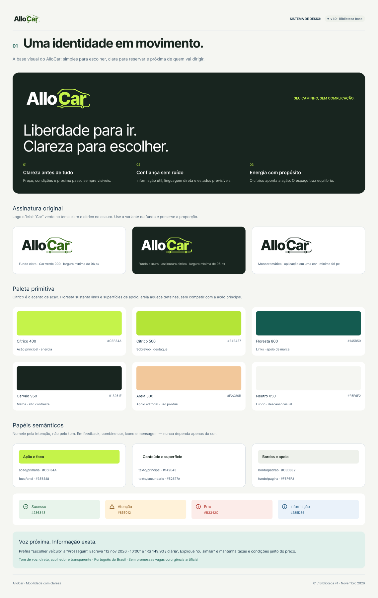
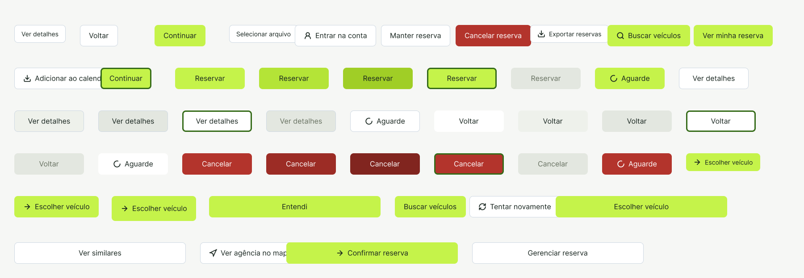
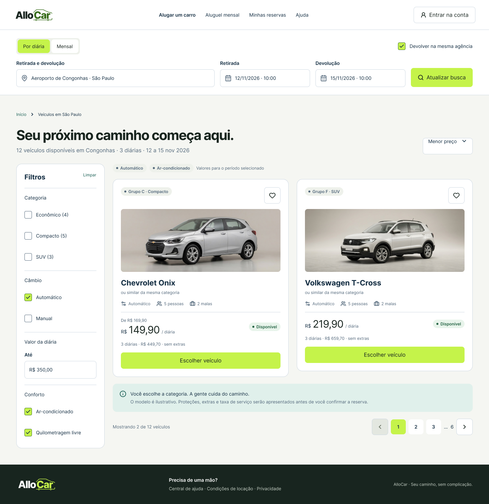

# AlloCar — Design System

O [Figma](https://www.figma.com/design/BhQ1Hh0Rofd4t0k7EVWZgK) reúne identidade visual, tokens, componentes nativos e exemplos de composição para as interfaces AlloCar.

## Organização do arquivo

| Página                    | Conteúdo                                                               | Link                                                                          |
| ------------------------- | ---------------------------------------------------------------------- | ----------------------------------------------------------------------------- |
| Design System             | 10 pranchas de fundações, componentes e aplicações; exposição da logo. | [Abrir](https://www.figma.com/design/BhQ1Hh0Rofd4t0k7EVWZgK?node-id=0-1)      |
| Componentes nativos       | Componentes principais e conjuntos de variantes AlloCar.               | [Abrir](https://www.figma.com/design/BhQ1Hh0Rofd4t0k7EVWZgK?node-id=14-22158) |
| Protótipo alta fidelidade | 27 telas, duas landings e mapa da jornada.                             | [Abrir](https://www.figma.com/design/BhQ1Hh0Rofd4t0k7EVWZgK?node-id=4-826)    |
| Wireframes                | 27 telas, duas landings e mapa em baixa fidelidade.                    | [Abrir](https://www.figma.com/design/BhQ1Hh0Rofd4t0k7EVWZgK?node-id=4-1683)   |

As dez pranchas apresentam identidade e cores, tipografia e estrutura, ações, formulários, navegação, feedback e sobreposições, dados e conteúdo, padrões de locação, aplicação desktop e aplicação móvel.

## Identidade e logo

A assinatura integra o contorno de um carro ao nome **AlloCar**. A variante clara usa Car verde; a escura usa branco e cítrico. A prancha recomenda preservar a proporção e largura mínima de 96 px.

| Aplicação     | Componente de origem                | Asset oficial                            |
| ------------- | ----------------------------------- | ---------------------------------------- |
| Fundo claro   | `27:1565` — Aplicacao=Fundo claro   | [SVG](../allocar-logo-claro.svg)         |
| Fundo escuro  | `25:1566` — Aplicacao=Fundo escuro  | [SVG](../allocar-logo.svg)               |
| Monocromática | `27:1572` — Aplicacao=Monocromatica | [SVG](../allocar-logo-monocromatica.svg) |

Os SVGs foram exportados do conjunto [AlloCar/Logo](https://www.figma.com/design/BhQ1Hh0Rofd4t0k7EVWZgK?node-id=27-1579), com o texto convertido em contornos para preservar a aparência sem depender da instalação da fonte.

## Tokens e estilos

| Coleção / estilo                 | Quantidade | Observação                                                                              |
| -------------------------------- | ---------- | --------------------------------------------------------------------------------------- |
| Primitivos                       | 57         | Cores, espaços e raios; modo Base.                                                      |
| Semânticos                       | 29         | Papéis visuais por aliases dos primitivos; modo Claro.                                  |
| AlloCar / Interface              | 7          | Tokens da interface.                                                                    |
| AlloCar / Wireframe              | 7          | Tokens neutros dos wireframes.                                                          |
| AlloCar / Navegação de protótipo | 8          | Perfil, decisão, justificativa, crédito e visibilidade; estados de demonstração.        |
| AlloCar / Seleção do automóvel   | 25         | Textos do automóvel, fotos, filtros, tipo institucional e estado da lista de contratos. |
| Estilos de texto                 | 53         | Inter; títulos, subtítulos, corpo e legendas em diferentes tamanhos/pesos.              |
| Estilos de elevação              | 3          | Sombras com raios de 8, 24 e 48 px.                                                     |

As seis coleções totalizam 133 variáveis: 86 de fundações, 14 das coleções Interface/Wireframe e 33 de interação. <!--O [inventário de interação](interacao-expansao.json) descreve IDs, tipos e escopos das variáveis de seleção de automóvel, filtros, tipo institucional e lista de contratos. Variáveis de interação são separadas dos tokens de marca.-->

| Uso                          | Cor       |
| ---------------------------- | --------- |
| Ação primária / Cítrico 400  | `#C5F34A` |
| Hover primário / Cítrico 500 | `#B4E437` |
| Marca / Carvão 950           | `#18251F` |
| Links e apoio / Floresta 800 | `#145B50` |
| Página / Neutro 050          | `#F5F6F2` |
| Texto primário               | `#142E43` |
| Texto secundário             | `#52677A` |
| Logo no fundo claro / foco   | `#356B18` |
| Apoio editorial / Areia      | `#F2C89B` |

## Biblioteca nativa

A biblioteca reúne **65 famílias no nível da página**: 43 componentes independentes e 22 conjuntos de variantes. Há 201 componentes principais ao todo, dos quais 158 são variantes dentro de conjuntos. Esses números não equivalem às instâncias usadas nas telas.

| Grupo         | Exemplos                                                                                                                                          |
| ------------- | ------------------------------------------------------------------------------------------------------------------------------------------------- |
| Marca e ações | Logo, Marca, Botao, BotaoIcone, GrupoAcoes, Link.                                                                                                 |
| Formulários   | Campo, AreaTexto, Selecao, CaixaSelecao, Radio, Interruptor, Upload, Quantidade, Calendario.                                                      |
| Navegação     | Cabecalho, Migalhas, Abas, Paginacao, Etapas, MenuConta, NavegacaoLateral, NavegacaoInferior.                                                     |
| Feedback      | Selo, Alerta, AvisoTemporario, Dialogo, Modal, EstadoVazio, EstadoErro, Carregamento, Esqueleto, Progresso.                                       |
| Dados         | Tabela, LinhaTabela, CartaoConteudo, ItemLista, Lista, Avatar, Metadados.                                                                         |
| Locação       | CartaoVeiculo, BuscaLocacao, Filtros, Tarifa, Modalidade, Protecao, Extra, ResumoReserva, Confirmacao, StatusReserva, Cupom, Condicoes, Politica. |

As variantes usam a propriedade `Modelo`; a logo usa `Aplicacao`. Por exemplo, Botao possui 47 variantes, Campo 18 e Logo três aplicações. <!--O [inventário](inventario-figma.json) contém os IDs, nomes e dimensões de todas as famílias e variantes, bem como as pranchas do design system.-->

## Exemplos de aplicação

As aplicações na página Design System demonstram a composição da biblioteca e orientam a organização das 27 telas de alta fidelidade.

| Exemplo                   | Origem                                                                                              | Prévia                     |
| ------------------------- | --------------------------------------------------------------------------------------------------- | -------------------------- |
| Busca de veículos desktop | [Prancha 09](https://www.figma.com/design/BhQ1Hh0Rofd4t0k7EVWZgK?node-id=14-21207), largura 1440 px | [PNG](exemplo-desktop.png) |
| Resumo da reserva móvel   | [Prancha 10](https://www.figma.com/design/BhQ1Hh0Rofd4t0k7EVWZgK?node-id=14-21411), largura 390 px  | [PNG](exemplo-mobile.png)  |

Os exemplos da biblioteca incluem agências, horários, categorias, extras, proteção, cupons, mensalidade, CNH e documentos. A [modelagem](../modelagem.md) define as operações e os dados de negócio. A busca de veículos exige autenticação.

## Aplicação no produto

As 27 telas do sistema usam a biblioteca existente. A busca reutiliza CartaoVeiculo e Campo; o resumo lateral usa ResumoReserva, com extras, proteção e cupom ocultados para adequação ao projeto. Detalhes e consultas reutilizam Metadados; navegação e ações usam Logo e Botao. A landing mantém CartaoConteudo e Acordeao. As interfaces permanecem editáveis e as fotos vêm dos componentes existentes.

O cabeçalho ocupa toda a largura e o conteúdo se organiza em um grid central, com formulários, cartões e apoio lateral. Os wireframes recebem a mesma estrutura e navegação com superfícies neutras, sem fotografias, efeitos ou cores de marca. Veja as [referências e decisões de escopo](../prototipos/referencias-e-escopo.md).

Os wireframes de baixa fidelidade preservam a organização e os fluxos, com marca textual, contornos neutros, fotografias substituídas por blocos e sem efeitos. Consulte as [prévias e roteiros](../prototipos/README.md).
