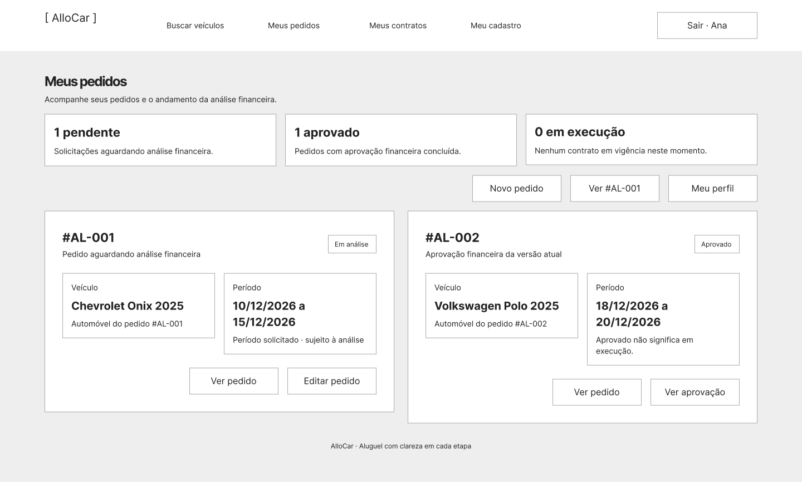
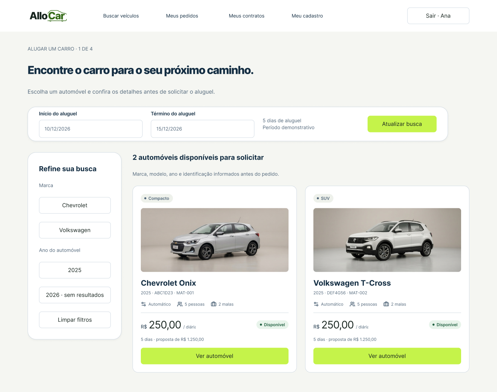
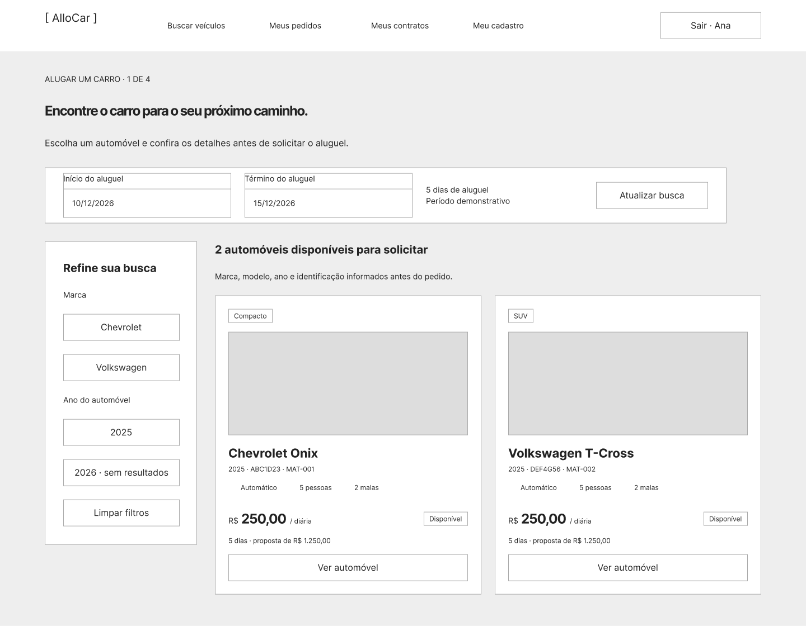
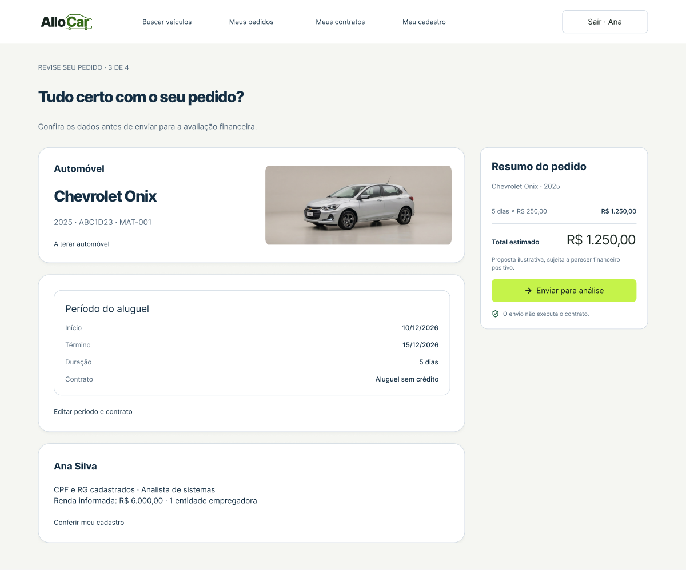
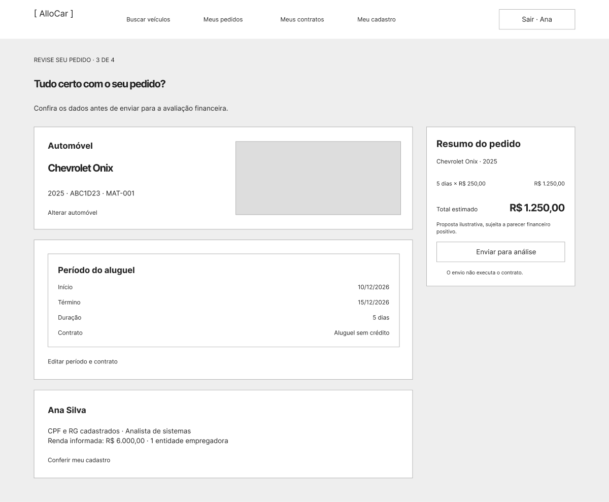

# AlloCar — Protótipos

Os protótipos no [Figma](https://www.figma.com/design/BhQ1Hh0Rofd4t0k7EVWZgK) apresentam 27 telas do sistema, duas landings e oito painéis auxiliares em cada fidelidade.

O layout usa os exemplos de busca e resumo do design system: cabeçalho em toda a largura, conteúdo central, filtros, cartões de veículos e resumo lateral. As [referências oficiais de Localiza/Movida e decisões de escopo](referencias-e-escopo.md) explicam a organização dos fluxos.

- [Apresentar alta fidelidade](https://www.figma.com/proto/BhQ1Hh0Rofd4t0k7EVWZgK?node-id=4-1017&starting-point-node-id=4%3A1017).
- [Apresentar baixa fidelidade](https://www.figma.com/proto/BhQ1Hh0Rofd4t0k7EVWZgK?node-id=4-1697&starting-point-node-id=4%3A1697).
- [Biblioteca e identidade visual](../design-system/README.md).

## Landing page

- [Apresentar desktop](https://www.figma.com/proto/BhQ1Hh0Rofd4t0k7EVWZgK?node-id=77-2376&starting-point-node-id=77%3A2376) · [Apresentar mobile](https://www.figma.com/proto/BhQ1Hh0Rofd4t0k7EVWZgK?node-id=77-2377&starting-point-node-id=77%3A2377).
- Wireframes: [desktop](https://www.figma.com/design/BhQ1Hh0Rofd4t0k7EVWZgK?node-id=81-3221) · [mobile](https://www.figma.com/design/BhQ1Hh0Rofd4t0k7EVWZgK?node-id=81-3222).
- Prévias: [desktop](landing-desktop.png) · [mobile](landing-mobile.png).

A composição inclui navegação, apresentação, etapas do aluguel, categorias, dúvidas, CTA de cadastro e rodapé. Os valores de veículos são ilustrativos. A página pública não expõe dados de pedidos nem libera operações sem autenticação. A landing possui aplicação mobile; as telas do sistema são desktop.

## Conteúdo por fidelidade

| Evidência                                                                | Wireframes | Alta fidelidade |
| ------------------------------------------------------------------------ | ---------- | --------------- |
| Telas do sistema                                                         | 27         | 27              |
| Landing desktop/mobile                                                   | 2          | 2               |
| Painéis auxiliares                                                       | 8          | 8               |
| Mapa da jornada                                                          | 1          | 1               |
| Instâncias em todas as telas, incluindo aninhadas e alternativas ocultas | 298        | 298             |
| Controles configurados com clique nas telas e landings                   | 258        | 258             |
| Controles de clique nos painéis                                          | 12         | 12              |
| Total de controles com clique                                            | 270        | 270             |
| Ramos de navegação/rolagem, contando destinos condicionais               | 259        | 259             |

| Fonte | Inter | Inter |

Controles alternativos de estado e controles ocultos preservados são contados separadamente; o total representa as reações configuradas, e não os cliques disponíveis simultaneamente. Retornos que fecham painéis também entram na contagem; não são novas telas principais.

Os wireframes reproduzem a **estrutura**, os agrupamentos, os formulários, a tabela do agente e as ações da interface. O tratamento de baixa fidelidade usa fundos neutros, contornos retos, marca em texto, tipografia simplificada e sem ilustrações, cores de marca ou sombras. As instâncias recebem overrides locais.

## Telas e rastreabilidade

| Tela                                  | Wireframe                                                                   | Alta fidelidade                                                             |
| ------------------------------------- | --------------------------------------------------------------------------- | --------------------------------------------------------------------------- |
| 01 · Acesso à AlloCar                 | [BF01](https://www.figma.com/design/BhQ1Hh0Rofd4t0k7EVWZgK?node-id=4-1697)  | [AF01](https://www.figma.com/design/BhQ1Hh0Rofd4t0k7EVWZgK?node-id=4-1017)  |
| 02 · Crie sua conta · AlloCar         | [BF02](https://www.figma.com/design/BhQ1Hh0Rofd4t0k7EVWZgK?node-id=4-1747)  | [AF02](https://www.figma.com/design/BhQ1Hh0Rofd4t0k7EVWZgK?node-id=4-1071)  |
| 03 · Seu cadastro · AlloCar           | [BF03](https://www.figma.com/design/BhQ1Hh0Rofd4t0k7EVWZgK?node-id=4-1810)  | [AF03](https://www.figma.com/design/BhQ1Hh0Rofd4t0k7EVWZgK?node-id=4-1134)  |
| 04 · Meus pedidos · AlloCar           | [BF04](https://www.figma.com/design/BhQ1Hh0Rofd4t0k7EVWZgK?node-id=4-1872)  | [AF04](https://www.figma.com/design/BhQ1Hh0Rofd4t0k7EVWZgK?node-id=4-1196)  |
| 05 · Novo pedido de aluguel · AlloCar | [BF05](https://www.figma.com/design/BhQ1Hh0Rofd4t0k7EVWZgK?node-id=4-1910)  | [AF05](https://www.figma.com/design/BhQ1Hh0Rofd4t0k7EVWZgK?node-id=4-1234)  |
| 06 · Pedido #AL-001                   | [BF06](https://www.figma.com/design/BhQ1Hh0Rofd4t0k7EVWZgK?node-id=4-1964)  | [AF06](https://www.figma.com/design/BhQ1Hh0Rofd4t0k7EVWZgK?node-id=4-1288)  |
| 07 · Alterar pedido #AL-001           | [BF07](https://www.figma.com/design/BhQ1Hh0Rofd4t0k7EVWZgK?node-id=4-2002)  | [AF07](https://www.figma.com/design/BhQ1Hh0Rofd4t0k7EVWZgK?node-id=4-1326)  |
| 08 · Cancelar pedido?                 | [BF08](https://www.figma.com/design/BhQ1Hh0Rofd4t0k7EVWZgK?node-id=4-2056)  | [AF08](https://www.figma.com/design/BhQ1Hh0Rofd4t0k7EVWZgK?node-id=4-1380)  |
| 09 · Pedido cancelado                 | [BF09](https://www.figma.com/design/BhQ1Hh0Rofd4t0k7EVWZgK?node-id=4-2085)  | [AF09](https://www.figma.com/design/BhQ1Hh0Rofd4t0k7EVWZgK?node-id=4-1409)  |
| 10 · Central do agente                | [BF10](https://www.figma.com/design/BhQ1Hh0Rofd4t0k7EVWZgK?node-id=4-2104)  | [AF10](https://www.figma.com/design/BhQ1Hh0Rofd4t0k7EVWZgK?node-id=4-1428)  |
| 11 · Análise do pedido #AL-001        | [BF11](https://www.figma.com/design/BhQ1Hh0Rofd4t0k7EVWZgK?node-id=4-2136)  | [AF11](https://www.figma.com/design/BhQ1Hh0Rofd4t0k7EVWZgK?node-id=4-1460)  |
| 12 · Contrato do pedido #AL-001       | [BF12](https://www.figma.com/design/BhQ1Hh0Rofd4t0k7EVWZgK?node-id=4-2184)  | [AF12](https://www.figma.com/design/BhQ1Hh0Rofd4t0k7EVWZgK?node-id=4-1508)  |
| 13 · Pedido não aprovado              | [BF13](https://www.figma.com/design/BhQ1Hh0Rofd4t0k7EVWZgK?node-id=4-2243)  | [AF13](https://www.figma.com/design/BhQ1Hh0Rofd4t0k7EVWZgK?node-id=4-1567)  |
| 14 · Não foi possível entrar          | [BF14](https://www.figma.com/design/BhQ1Hh0Rofd4t0k7EVWZgK?node-id=4-2271)  | [AF14](https://www.figma.com/design/BhQ1Hh0Rofd4t0k7EVWZgK?node-id=4-1595)  |
| 15 · Contrato em execução             | [BF15](https://www.figma.com/design/BhQ1Hh0Rofd4t0k7EVWZgK?node-id=4-2305)  | [AF15](https://www.figma.com/design/BhQ1Hh0Rofd4t0k7EVWZgK?node-id=4-1629)  |
| 16 · Crédito associado                | [BF16](https://www.figma.com/design/BhQ1Hh0Rofd4t0k7EVWZgK?node-id=4-2315)  | [AF16](https://www.figma.com/design/BhQ1Hh0Rofd4t0k7EVWZgK?node-id=4-1639)  |
| 17 · Busca de veículos                | [BF17](https://www.figma.com/design/BhQ1Hh0Rofd4t0k7EVWZgK?node-id=95-2527) | [AF17](https://www.figma.com/design/BhQ1Hh0Rofd4t0k7EVWZgK?node-id=92-2697) |
| 18 · Detalhes do automóvel            | [BF18](https://www.figma.com/design/BhQ1Hh0Rofd4t0k7EVWZgK?node-id=95-2528) | [AF18](https://www.figma.com/design/BhQ1Hh0Rofd4t0k7EVWZgK?node-id=92-2698) |
| 19 · Resumo do pedido                 | [BF19](https://www.figma.com/design/BhQ1Hh0Rofd4t0k7EVWZgK?node-id=95-2529) | [AF19](https://www.figma.com/design/BhQ1Hh0Rofd4t0k7EVWZgK?node-id=92-2699) |
| 20 · Pedido enviado para análise      | [BF20](https://www.figma.com/design/BhQ1Hh0Rofd4t0k7EVWZgK?node-id=95-2530) | [AF20](https://www.figma.com/design/BhQ1Hh0Rofd4t0k7EVWZgK?node-id=92-2700) |
| 21 · Meus contratos                   | [BF21](https://www.figma.com/design/BhQ1Hh0Rofd4t0k7EVWZgK?node-id=95-2531) | [AF21](https://www.figma.com/design/BhQ1Hh0Rofd4t0k7EVWZgK?node-id=92-2701) |
| 22 · Detalhes do contrato             | [BF22](https://www.figma.com/design/BhQ1Hh0Rofd4t0k7EVWZgK?node-id=95-2532) | [AF22](https://www.figma.com/design/BhQ1Hh0Rofd4t0k7EVWZgK?node-id=92-2702) |
| 23 · Associar crédito · Banco         | [BF23](https://www.figma.com/design/BhQ1Hh0Rofd4t0k7EVWZgK?node-id=95-2533) | [AF23](https://www.figma.com/design/BhQ1Hh0Rofd4t0k7EVWZgK?node-id=92-2703) |
| 24 · Histórico de pareceres           | [BF24](https://www.figma.com/design/BhQ1Hh0Rofd4t0k7EVWZgK?node-id=95-2534) | [AF24](https://www.figma.com/design/BhQ1Hh0Rofd4t0k7EVWZgK?node-id=92-2704) |
| 25 · Busca sem resultados             | [BF25](https://www.figma.com/design/BhQ1Hh0Rofd4t0k7EVWZgK?node-id=95-2535) | [AF25](https://www.figma.com/design/BhQ1Hh0Rofd4t0k7EVWZgK?node-id=92-2705) |
| 26 · Créditos do banco                | [BF26](https://www.figma.com/design/BhQ1Hh0Rofd4t0k7EVWZgK?node-id=95-2536) | [AF26](https://www.figma.com/design/BhQ1Hh0Rofd4t0k7EVWZgK?node-id=92-2706) |
| 27 · Cadastro institucional           | [BF27](https://www.figma.com/design/BhQ1Hh0Rofd4t0k7EVWZgK?node-id=95-2537) | [AF27](https://www.figma.com/design/BhQ1Hh0Rofd4t0k7EVWZgK?node-id=92-2707) |

As [histórias de usuário](../historias-de-usuario.md) relacionam as interfaces às operações e aos elementos do domínio.

| Busca em alta fidelidade             | Wireframe correspondente                      |
| ------------------------------------ | --------------------------------------------- |
|  |  |

| Resumo em alta fidelidade            | Wireframe correspondente                        |
| ------------------------------------ | ----------------------------------------------- |
|  |  |

## Roteiros de navegação

1. **Cliente:** entrar como cliente → Busca → Ver automóvel → Selecionar → Período/tipo → Revisar pedido → Enviar para análise → Acompanhar pedido.
2. **Cadastro:** acesso → Criar conta → Voltar/confirmar → acesso; Meu perfil → Salvar → Meus pedidos.
3. **Alteração:** detalhe → Alterar pedido → Salvar e reenviar → detalhe. Quando iniciada pelo agente, salvar retorna à central e descartar retorna à análise.
4. **Cancelamento:** detalhe → Cancelar pedido → Manter pedido retorna ao detalhe; Confirmar leva a Pedido cancelado → Meus pedidos.
5. **Erro:** no acesso, Simular credenciais inválidas → erro → Tentar novamente.
6. **Agente:** entrar como agente → Central → Analisar #AL-001 → clicar no seletor de decisão.
7. **Aprovação:** escolher Aprovar → conferir a justificativa ilustrativa → Salvar decisão → contrato → Executar → confirmação; Visualizar contrato abre consulta de CT-001.
8. **Reprovação:** escolher Reprovar → Salvar decisão → pedido não aprovado → Revisar pedido. O retorno mantém o contexto do perfil.
9. **Obrigatoriedade:** antes de escolher decisão, Salvar decisão abre orientação e não avança ao contrato.
10. **Banco:** contrato → Associar crédito → recibo → Consultar pedido vinculado. Ao voltar ao contrato, o resumo passa de proposto para associado. Voltar aos créditos abre a consulta bancária; dela é possível retornar à fila.
11. **Outros pedidos:** os controles do #AL-002 abrem os dados aprovados do Polo; a linha do #AL-003 consulta os dados de Carlos Lima, sem abrir o pedido de Ana.

12. **Busca:** alternar Chevrolet/Volkswagen → consultar o veículo escolhido; selecionar 2026 → sem resultados → limpar filtros.
13. **Revisão:** alterar automóvel → voltar à busca; editar período/tipo → formulário; conferir cadastro → perfil.
14. **Contratos:** Meus contratos → estado vazio; após aprovar e executar, consultar CT-001 → detalhe do contrato.
15. **Banco:** Associar crédito → preencher formulário demonstrativo → confirmar associação → consultar créditos.
16. **Instituição:** cadastro de cliente → Cadastrar empresa ou banco → escolher tipo → concluir → acesso.
17. **Pareceres:** análise → Consultar histórico → Abrir análise atual.

As entradas de apresentação incluem landing desktop/mobile, acesso e central do agente. O mapa da jornada de cada fidelidade permite abrir as 27 telas do sistema. Na alta há também entradas diretas para revisar busca e crédito.

## Painéis auxiliares

| Consulta / ação     | Wireframes                                                                   | Alta fidelidade                                                              |
| ------------------- | ---------------------------------------------------------------------------- | ---------------------------------------------------------------------------- |
| Escolher decisão    | [Abrir](https://www.figma.com/design/BhQ1Hh0Rofd4t0k7EVWZgK?node-id=63-4671) | [Abrir](https://www.figma.com/design/BhQ1Hh0Rofd4t0k7EVWZgK?node-id=62-2542) |
| Decisão obrigatória | [Abrir](https://www.figma.com/design/BhQ1Hh0Rofd4t0k7EVWZgK?node-id=63-4672) | [Abrir](https://www.figma.com/design/BhQ1Hh0Rofd4t0k7EVWZgK?node-id=62-2554) |
| Pedido AL-002       | [Abrir](https://www.figma.com/design/BhQ1Hh0Rofd4t0k7EVWZgK?node-id=63-4673) | [Abrir](https://www.figma.com/design/BhQ1Hh0Rofd4t0k7EVWZgK?node-id=62-2560) |
| Consultar CT-001    | [Abrir](https://www.figma.com/design/BhQ1Hh0Rofd4t0k7EVWZgK?node-id=63-4674) | [Abrir](https://www.figma.com/design/BhQ1Hh0Rofd4t0k7EVWZgK?node-id=62-2566) |
| Créditos do banco   | [Abrir](https://www.figma.com/design/BhQ1Hh0Rofd4t0k7EVWZgK?node-id=63-4675) | [Abrir](https://www.figma.com/design/BhQ1Hh0Rofd4t0k7EVWZgK?node-id=62-2572) |
| Pedido AL-003       | [Abrir](https://www.figma.com/design/BhQ1Hh0Rofd4t0k7EVWZgK?node-id=63-4676) | [Abrir](https://www.figma.com/design/BhQ1Hh0Rofd4t0k7EVWZgK?node-id=62-2581) |
| Ajuda               | [Abrir](https://www.figma.com/design/BhQ1Hh0Rofd4t0k7EVWZgK?node-id=63-4677) | [Abrir](https://www.figma.com/design/BhQ1Hh0Rofd4t0k7EVWZgK?node-id=62-2587) |
| Documentos          | [Abrir](https://www.figma.com/design/BhQ1Hh0Rofd4t0k7EVWZgK?node-id=63-4678) | [Abrir](https://www.figma.com/design/BhQ1Hh0Rofd4t0k7EVWZgK?node-id=62-2593) |

Os painéis permitem escolher decisão, explicar a obrigatoriedade, consultar #AL-002 e #AL-003, ler CT-001, consultar créditos, abrir ajuda e consultar orientação sobre documentos. A navegação dos painéis permanece na mesma fidelidade.

## Estados da demonstração

A coleção **AlloCar / Navegação de protótipo** contém oito variáveis: perfil, decisão, justificativa, resumo/nota do crédito, execução e dois indicadores complementares de seleção. O seletor oferece Aprovar e Reprovar; a escolha atualiza a justificativa ilustrativa e permite salvar. Sem escolha, o botão de orientação fica visível. Ao iniciar outro acesso ou reenviar a edição, os estados pertinentes são reinicializados.

A coleção **AlloCar / Seleção do automóvel** contém 25 variáveis. Onix e T-Cross atualizam identificação, marca/modelo e foto no detalhe, além dos textos do pedido e das consultas. Os filtros mudam os cartões e a contagem. O cadastro institucional alterna Empresa/Banco; a lista de contratos alterna vazio/CT-001 após execução e é reiniciada no acesso. As duas fidelidades compartilham os estados de demonstração, com destinos separados.

As duas fidelidades usam os mesmos estados de demonstração, com destinos separados por página. Ao escolher a decisão, a justificativa recebe um texto de exemplo.

## Artefatos e manutenção

- [Painel em alta fidelidade](alta-fidelidade.png), [login com cenário de erro](login-alta.png), [análise em alta](analise-alta.png), [seletor financeiro](decisao-alta.png) e [contrato](contrato-alta-fidelidade.png).
- [Automóvel](automovel-alta.png), [crédito](credito-alta.png), [central do agente](agente-alta.png) e [cadastro institucional](cadastro-institucional.png).

<!--- [Inventário de alta](alta-figma.json) e [de baixa](baixa-figma.json): `schemaVersion: 4`, com dimensões, tipos de nós, fontes, imagens de conteúdo, fontes/destinos das reações, âncoras de rolagem, ações condicionais e vínculos de visibilidade.
- [Scripts de edição e validação](../figma/README.md): manutenção das interfaces. Os JSONs são inventários e não backups completos do arquivo.-->
